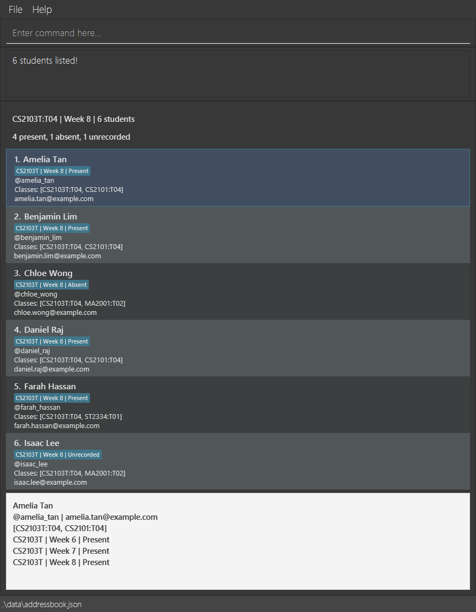

TutorTrack is a desktop application for teaching staff to manage student contacts and course/group memberships using typed commands. This version supports student creation and retains legacy AB3 contacts. Class/week filtering and attendance commands are being integrated separately.

* Table of Contents
{:toc}

--------------------------------------------------------------------------------------------------------------------

## Quick start

1. Ensure that Java `25` or later is installed on your computer. 
   **Mac users:** Ensure you have the precise JDK version prescribed [here](https://se-education.org/guides/tutorials/javaInstallationMac.html).

1. Download the latest `.jar` file from [here](https://github.com/AY2627S1-CS2103T-W08-4/tp/releases).

1. Copy the file to the folder you want to use as the _home folder_ for your AddressBook.

1. Open a terminal, `cd` to the folder containing the JAR file, and run `java -jar addressbook.jar`. 
   A GUI similar to the one below should appear in a few seconds. Note how the app contains some sample data. 
   

1. Type a command in the command box and press Enter to execute it. For example, type **`help`** and press Enter to open the help window. 
   Some example commands you can try:

   * `list` : Lists all contacts.

   * `add n/John Doe p/@johndoe e/johnd@example.com c/CS2103T:T04` : Adds a student named `John Doe`.

   * `delete 3` : Deletes the 3rd contact shown in the current list.

   * `clear` : Deletes all contacts.

   * `exit` : Exits the app.

1. Refer to the [Features](#features) section below for details of each command.

--------------------------------------------------------------------------------------------------------------------

## Features

**:information_source: Notes about the command format:** 

* Words in `UPPER_CASE` are the parameters to be supplied by the user. 
  For example, in `add n/NAME`, replace `NAME` with a value such as `John Doe`.

* Items in square brackets are optional. 
  For example, `n/NAME [t/TAG]` can be used as `n/John Doe t/friend` or as `n/John Doe`.

* Items followed by `…`​ can appear zero or more times. 
  For example, `[t/TAG]…​` may be omitted, or written as `t/friend` or `t/friend t/family`.

* Parameters can be in any order. 
  For example, if the command specifies `n/NAME p/PHONE_NUMBER`, `p/PHONE_NUMBER n/NAME` is also acceptable.

* Extraneous parameters for `help`, `list`, and `clear` are ignored. 
  For example, `help 123` is interpreted as `help`.

* `exit` takes no parameters. Extra arguments produce a format error and keep the application open. 
  For example, `exit 123` is rejected.

* If you are using a PDF version of this document, be careful when copying and pasting commands that span multiple lines as space characters surrounding line-breaks may be omitted when copied over to the application.

### Viewing help: `help`

Shows a message explaining how to access the help page.

Format: `help`

### Adding a student: `add`

Creates and saves one complete student profile.

Format: `add n/NAME p/TELEGRAM e/EMAIL c/COURSE:GROUP [c/COURSE:GROUP ...]`

Examples:

* `add n/John Doe p/@johndoe e/johnd@example.com c/CS2103T:T04`
* `add n/Anne-Marie Tan p/@anne_tan e/anne@example.com c/CS2103T:T04 c/MA2001:T02`
* `add e/alice@example.com c/cs2103t:t04 n/ Alice   Lim p/@Alice_1`

Supply `n/`, `p/` and `e/` exactly once, and at least one `c/`. Parameter order is free.
Commands and prefixes are lowercase and case-sensitive. Only surrounding ordinary spaces are removed;
tabs and line breaks are not accepted as field whitespace. Unknown prefixes, including the old `a/`
and `t/` add parameters, are rejected.

| Field | Accepted input |
| --- | --- |
| Name | 1–50 Unicode code points after NFC normalization and collapsing ordinary spaces. Must contain a letter. Letters, combining marks, spaces, apostrophes (`'` or `’`), hyphens and periods are allowed. Capitalization is preserved. |
| Telegram | `@` followed by 5–32 ASCII letters/digits/underscores, starting with a letter. Stored lowercase. |
| Email | At most 254 characters with one `@`, a 1–64-character ASCII local part and a dotted domain. The local part starts/ends alphanumeric, allows `._+-` internally and forbids consecutive periods. Domain labels contain 1–63 letters/digits/hyphens, start/end alphanumeric, and the final label has 2–63 letters. Stored lowercase. |
| Class membership | `COURSE:GROUP`, with no internal spaces. Course: 2–4 ASCII letters, 4 digits, optional final letter. Group: one ASCII letter and 2 digits. Stored uppercase. Repeat `c/` for different courses; each course may appear only once. |

Namesakes are allowed. A matching email or Telegram handle rejects the entire addition, regardless of
name or memberships. Email collisions are reported first, including collisions with existing legacy
contact emails. No records are merged or updated.

On success, TutorTrack saves the complete student, appends it to the roster, shows the full roster and
selects the new row. The detail area shows normalized contacts, memberships and `No attendance recorded.`
The result is `New student added: NAME.` No attendance records are created by adding a student.

Examples of errors:

* Missing email: `Missing required parameter: e/.`
* Repeated email prefix: `Parameter e/ must be specified only once.`
* Unknown parameter: `Unknown parameter: x/.`
* Duplicate email: `A student with this email already exists.`
* Duplicate Telegram: `A student with this Telegram handle already exists.`
* Repeated course: `Course CS2103T may be specified only once per student.`

If saving fails, TutorTrack reports `Unable to save changes. No changes were applied. Check available
disk space and file permissions, then try again.` The existing data, filter and selection are retained,
and the attempted command remains available for correction. Saving requires a filesystem that supports
atomic replacement in the data directory.

Existing AB3 phone/address/tag contacts remain readable without invented Telegram handles or memberships.
They are not automatically converted to student profiles. The `add` command only creates the new student format.

### Listing all persons: `list`

Shows a list of all persons in the address book.

Format: `list`

### Editing a person: `edit`

Edits an existing **legacy phone/address contact**. Editing new student profiles is outside this MVP increment; TutorTrack rejects it without changing their contacts or memberships.

Format: `edit INDEX [n/NAME] [p/PHONE] [e/EMAIL] [a/ADDRESS] [t/TAG]…​`

* Edits the person at the specified `INDEX`. The index refers to the index number shown in the displayed person list. The index **must be a positive integer** 1, 2, 3, …​
* At least one of the optional fields must be provided.
* Existing values will be updated to the input values.
* When editing tags, all of the person's existing tags are removed; adding tags is not cumulative.
* To remove all of a person's tags, enter `t/` without a tag after it.

Examples:
*  `edit 1 p/91234567 e/johndoe@example.com` Edits the phone number and email address of the 1st person to be `91234567` and `johndoe@example.com` respectively.
*  `edit 2 n/Betsy Crower t/` Edits the name of the 2nd person to be `Betsy Crower` and clears all existing tags.

### Locating persons by name: `find`

Finds persons whose names contain any of the given keywords.

Format: `find KEYWORD [MORE_KEYWORDS]`

* The search is case-insensitive; for example, `hans` matches `Hans`.
* Keyword order does not matter; for example, `Hans Bo` matches `Bo Hans`.
* The search considers only names.
* Only full words match; for example, `Han` does not match `Hans`.
* Persons matching at least one keyword are returned (an `OR` search); for example, `Hans Bo` returns `Hans Gruber` and `Bo Yang`.

Examples:
* `find John` returns `john` and `John Doe`
* `find alex david` returns `Alex Yeoh`, `David Li` 
  

### Deleting a person: `delete`

Deletes the specified person from the address book.

Format: `delete INDEX`

* Deletes the person at the specified `INDEX`.
* The index refers to the index number shown in the displayed person list.
* The index **must be a positive integer** 1, 2, 3, …​

Examples:
* `list` followed by `delete 2` deletes the 2nd person in the address book.
* `find Betsy` followed by `delete 1` deletes the 1st person in the results of the `find` command.

### Clearing all entries: `clear`

Clears all entries from the address book.

Format: `clear`

### Exiting the program: `exit`

Exits the program.

Format: `exit`

Surrounding spaces are accepted, for example `  exit  `. Extra arguments such as
`exit 3`, `exit anything`, or `exit n/Alice` show the correct usage without closing
the application or changing your data or current view. Enter `exit` to close the application.

### Saving the data

AddressBook automatically saves data after every command. You do not need to save manually.

### Editing the data file

AddressBook data is saved automatically as a JSON file `[JAR file location]/data/addressbook.json`. Advanced users are welcome to update data directly by editing that data file.

:exclamation: **Caution:**
If your changes make the data file invalid, AddressBook starts with an empty address book at the next run. The invalid file remains on disk until you run a command (AddressBook saves after every command). Still, we recommend backing up the file before editing it. 
Furthermore, certain edits can cause the AddressBook to behave in unexpected ways (e.g., if a value entered is outside of the acceptable range). Therefore, edit the data file only if you are confident that you can update it correctly.

### Archiving data files `[coming in v2.0]`

_Details coming soon ..._

--------------------------------------------------------------------------------------------------------------------

## FAQ

**Q**: How do I transfer my data to another computer? 
**A**: Install the app on the other computer and overwrite the data file it creates with the data file from your previous AddressBook home folder.

--------------------------------------------------------------------------------------------------------------------

## Known issues

1. **When using multiple screens**, if you move the application to a secondary screen, and later switch to using only the primary screen, the GUI will open off-screen. The remedy is to delete the `preferences.json` file created by the application before running the application again.
2. **If you minimize the Help Window** and then run the `help` command (or use the `Help` menu, or the keyboard shortcut `F1`) again, the original Help Window will remain minimized, and no new Help Window will appear. The remedy is to manually restore the minimized Help Window.

--------------------------------------------------------------------------------------------------------------------

## Command summary

Action | Format, Examples
--------|------------------
**Add** | `add n/NAME p/TELEGRAM e/EMAIL c/COURSE:GROUP [c/COURSE:GROUP ...]` e.g., `add n/John Doe p/@johndoe e/john@example.com c/CS2103T:T04`
**Clear** | `clear`
**Delete** | `delete INDEX`  e.g., `delete 3`
**Edit** | `edit INDEX [n/NAME] [p/PHONE_NUMBER] [e/EMAIL] [a/ADDRESS] [t/TAG]…​`  e.g., `edit 2 n/James Lee e/jameslee@example.com`
**Find** | `find KEYWORD [MORE_KEYWORDS]`  e.g., `find James Jake`
**List** | `list`
**Help** | `help`
