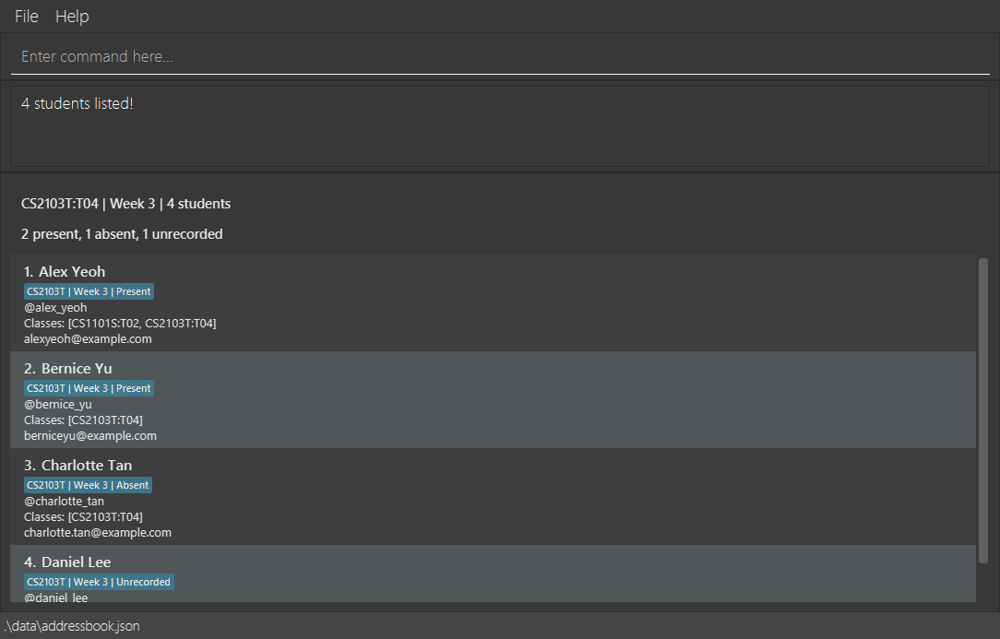

TutorTrack is a desktop application for teaching staff to manage student contacts and course/group memberships using typed commands. This guide covers TutorTrack v1.5, including contact correction with `update` and attendance commands that accept multiple student indices. TutorTrack supports creating students, viewing a class for a chosen week, recording/correcting/clearing attendance, deleting students and saving/reloading records. Legacy AB3 contacts remain readable.

* Table of Contents
{:toc}

--------------------------------------------------------------------------------------------------------------------

## Quick start

When no saved data file exists, TutorTrack starts with six fictional sample students.
They have Telegram handles and memberships across CS2103T (T04/T05) and CS1101S
(T02/T03); Alex Yeoh belongs to both courses. All attendance starts as Unrecorded.
Try `find c/CS2103T:T04 w/3`, then `mark 1 m/CS2103T w/3 s/present`.
Existing saved data, including legacy contacts, is loaded unchanged instead of these
examples. Updating the application does not replace your saved contacts.

1. Install Java `25`. The release was validated with Java 25; newer major versions are not yet verified.

1. Choose the JAR matching your Java installation:
   * `addressbook.jar`: standard build with Windows, Linux and Intel Mac JavaFX natives. On macOS, follow the [course Java installation guide](https://se-education.org/guides/tutorials/javaInstallationMac.html). A Java 25 distribution with bundled JavaFX also works; Zulu Java 25 FX on Apple Silicon was verified locally.
   * `tutortrack-macos-arm64.jar`: Apple Silicon Macs using an ARM64 Java 25 installation (for example Temurin). Run `java -jar tutortrack-macos-arm64.jar`.
   * Do not run the standard JAR with a plain ARM64 JDK without JavaFX; use the Apple Silicon JAR instead.

1. Download the latest `.jar` file from [here](https://github.com/AY2627S1-CS2103T-W08-4/tp/releases).

1. Copy the file to the folder you want to use as the _home folder_ for TutorTrack.

1. Open a terminal, `cd` to the folder containing the JAR file, and run `java -jar addressbook.jar`. 
   A GUI similar to the one below should appear in a few seconds. Note how the app contains some sample data. 
   

1. Type a command in the command box and press Enter to execute it. For example, type **`help`** and press Enter to open the help window. 
   Some example commands you can try:

   * `list` : Lists all students.

   * `add n/John Doe p/@johndoe e/johnd@example.com c/CS2103T:T04` : Adds a student named `John Doe`.

   * `delete 3` : Deletes the 3rd student shown in the current list.

   * `clear` : Deletes all student records.

   * `exit` : Exits the app.

1. Refer to the [Features](#features) section below for details of each command.

--------------------------------------------------------------------------------------------------------------------

## Viewing student details with the keyboard

You can browse student details without using the mouse:

1. Enter `list` to show all students, or use `find c/COURSE:GROUP w/WEEK` to show a class.
1. From the command box, press **Tab** until the roster (the list of students) has focus.
   The command results area receives focus before the roster.
1. Press **Up** or **Down** to select a student. Their name, Telegram handle, email,
   class memberships and attendance details appear below the roster and update as
   you change the selection. Selecting a student does not change their saved data.
1. Press **Shift+Tab** until focus returns to the command box, passing through the
   results area. You can then type your next command.

If the roster is empty, there is no student to select. Use `list` to leave an empty
class view, or `add` to create a student if no students have been saved.

--------------------------------------------------------------------------------------------------------------------

## Features

**:information_source: Notes about the command format:** 

* Words in `UPPER_CASE` are the parameters to be supplied by the user. 
  For example, in `add n/NAME`, replace `NAME` with a value such as `John Doe`.

* Items in square brackets are optional. 
  For example, `update INDEX [n/NAME] [e/EMAIL]` allows `update 1 n/John Doe` or `update 1 e/john@example.com`. At least one contact field is required.

* An ellipsis (`...`) indicates repetition. 
  For example, `mark INDEX [INDEX ...] m/COURSE w/WEEK s/STATUS` accepts one or more indices: `mark 1 m/CS2103T w/3 s/present` and `mark 1 2 m/CS2103T w/3 s/present` are both valid.

* Parameters can be in any order. 
  For example, `add p/@johndoe e/john@example.com c/CS2103T:T04 n/John Doe` has the same effect as putting `n/John Doe` first. For commands with indices, put all indices before the prefixed parameters.

* Extraneous parameters for `help` are ignored. 
  For example, `help 123` is interpreted as `help`.

* `list` takes no parameters. Extra input, including tabs or line breaks, produces a format error. 

* `exit` takes no parameters. Extra arguments produce a format error and keep the application open. 
  For example, `exit 123` is rejected.

* If you are using a PDF version of this document, be careful when copying and pasting commands that span multiple lines as space characters surrounding line-breaks may be omitted when copied over to the application.

### Viewing help: `help`

Shows a message explaining how to access the help page.

Format: `help`

### Adding a student: `add`

Creates and saves one complete student profile.

Format: `add n/NAME p/TELEGRAM e/EMAIL c/COURSE:GROUP [c/COURSE:GROUP ...]`

Examples:

* `add n/John Doe p/@johndoe e/johnd@example.com c/CS2103T:T04`
* `add n/Anne-Marie Tan p/@anne_tan e/anne@example.com c/CS2103T:T04 c/MA2001:T02`
* `add e/alice@example.com c/cs2103t:t04 n/ Alice   Lim p/@Alice_1`

Supply `n/`, `p/` and `e/` exactly once, and at least one `c/`. Parameter order is free.
Commands and prefixes are lowercase and case-sensitive. Only surrounding ordinary spaces are removed;
tabs and line breaks are not accepted as field whitespace. Unknown prefixes, including the old `a/`
and `t/` add parameters, are rejected.

| Field | Accepted input |
| --- | --- |
| Name | 1–50 Unicode code points after NFC normalization and collapsing ordinary spaces. Must contain a letter. Letters, combining marks, spaces, apostrophes (`'` or `’`), hyphens and periods are allowed. Standalone `s/o` and `d/o` relationship markers are also allowed, in any letter case. Capitalization is preserved. |
| Telegram | `@` followed by 5–32 ASCII letters/digits/underscores, starting with a letter. Stored lowercase. |
| Email | At most 254 characters with one `@`, a 1–64-character ASCII local part and a dotted domain. The local part starts/ends alphanumeric, allows `._+-` internally and forbids consecutive periods. Domain labels contain 1–63 letters/digits/hyphens, start/end alphanumeric, and the final label has 2–63 letters. Stored lowercase. |
| Class membership | `COURSE:GROUP`, with no internal spaces. Course: 2–4 ASCII letters, 4 digits, optional final letter. Group: one ASCII letter and 2 digits. Stored uppercase. Repeat `c/` for different courses; each course may appear only once. |

Name limits apply **after** normalization: for example, `n/ José   Tan ` is stored as
`José Tan`. Values are never shortened to fit a limit; an over-limit contact rejects
the whole command. Telegram and email lengths do not include surrounding ordinary spaces.

Relationship markers are literal name text inside `n/`; no quoting or escaping is needed.
For example, `add n/Ravi s/o Kumar p/@name_audit e/name.audit@example.com c/CS2103T:T04`
records `Ravi s/o Kumar`. The same rule supports `Priya d/o Raman` and uppercase
markers such as `S/O`. Each marker must be a complete word separated by ordinary spaces
(or at the beginning/end of the name). Other slash-containing text and unknown
parameters such as `x/` remain invalid.

Namesakes are allowed. A matching email or Telegram handle rejects the entire addition, regardless of
name or memberships. Email collisions are reported first, including collisions with existing legacy
contact emails. No records are merged or updated.

On success, TutorTrack saves the complete student, appends it to the roster, shows the full roster and
selects the new row. The detail area shows normalized contacts, memberships and `No attendance recorded.`
The result is `New student added: NAME.` No attendance records are created by adding a student.

Examples of errors:

* Missing email: `Missing required parameter: e/.`
* Repeated email prefix: `Parameter e/ must be specified only once.`
* Unknown parameter: `Unknown parameter: x/.`
* Duplicate email: `A student with this email already exists.`
* Duplicate Telegram: `A student with this Telegram handle already exists.`
* Repeated course: `Course CS2103T may be specified only once per student.`

If saving fails, TutorTrack reports `Unable to save changes. No changes were applied. Check available
disk space and file permissions, then try again.` The existing data, filter and selection are retained,
and the attempted command remains available for correction. Saving requires a filesystem that supports
atomic replacement in the data directory.

Existing AB3 phone/address/tag contacts remain readable without invented Telegram handles or memberships.
They are not automatically converted to student profiles. The `add` command only creates the new student format.

### Listing all students: `list`

Removes any active class filter and shows every saved entry once, in roster order. Older AB3 contacts
from an existing data file (without Telegram handles or classes) are listed and counted too.

Format: `list`

* The heading shows `All students | N students` (singular for one); selection/details are cleared. An empty roster says `No students saved. Use add to create a student.`
* `list` takes no parameters. Any extra input, such as `list 3` or `list c/CS2103T:T04`, is rejected with the list format error, so you never mistake an unfiltered list for a filtered one.
* The result shows how many students are listed, for example `3 students listed!`, `1 student listed!` or `0 students listed!`.

### Correcting student contacts: `update`

Format: `update INDEX [n/NAME] [p/TELEGRAM] [e/EMAIL]`

Examples:

* `update 1 e/alice.new@example.com` changes only the displayed student's email.
* `update 2 n/Anne-Marie Tan p/@anne_new` corrects a name and Telegram handle together.
* `update 2 n/Priya d/o Raman` preserves a relationship marker as part of the name.
* After `find c/CS2103T:T04 w/3`, `update 1 n/Alice Tan` targets row 1 of that class view.

Supply at least one field, each at most once, in any order. The name, Telegram and
email rules and normalization are the same as `add`; an empty value cannot erase a
required contact. Unknown parameters (including `c/`, `a/` and `t/`) are rejected.
The index is one displayed row: an ASCII integer from 1 to 2147483647, without
signs or leading zeros. Extra indices are rejected.

Omitted contacts, class memberships and all attendance records are preserved.
Namesakes are allowed. An email or Telegram matching another saved contact rejects
the entire update, even when that contact is hidden by the current filter. Email
collisions are reported before Telegram collisions. Your own unchanged contacts
are allowed. After a successful contact change, the old email or Telegram can be used
by another student, provided nobody else currently uses it. Use `edit` for legacy
phone/address contacts.

Success reports `Student updated: NAME.`, retains roster order and the current
class/week view, and selects the updated student with refreshed details. If all
supplied values normalize to existing values, the result is `Student unchanged: NAME.`;
the student is selected without another disk write.

Changes are saved before success and survive restart. Invalid input or a save
failure leaves the data, filter and selection unchanged. On a save failure, the
command stays in the input box and the same recovery message as `add` is shown.
Resolve the storage problem and resubmit. Membership editing is not supported;
`update` cannot move a student between groups or erase attendance.

### Editing a legacy contact: `edit`

Edits an existing **legacy phone/address contact**. Use `update` for student contacts; `edit` rejects student targets with guidance to that command.

Format: `edit INDEX [n/NAME] [p/PHONE] [e/EMAIL] [a/ADDRESS] [t/TAG]…​`

* Edits the person at the specified `INDEX`. The index refers to the index number shown in the displayed person list. The index **must be a positive integer** 1, 2, 3, …​
* At least one of the optional fields must be provided.
* Existing values will be updated to the input values.
* When editing tags, all of the person's existing tags are removed; adding tags is not cumulative.
* To remove all of a person's tags, enter `t/` without a tag after it.

Examples:
*  `edit 1 p/91234567 e/johndoe@example.com` Edits the phone number and email address of the 1st person to be `91234567` and `johndoe@example.com` respectively.
*  `edit 2 n/Betsy Crower t/` Edits the name of the 2nd person to be `Betsy Crower` and clears all existing tags.

Successful legacy edits are saved before the full roster is shown and selection is
cleared. If saving fails, the original contacts, view and selection remain intact,
and the attempted command stays available for correction. Resolve the storage
problem and retry; the recovery message is the same as for `add`.

### Viewing a class and teaching week: `find`

Format: `find c/COURSE:GROUP w/WEEK`

Examples:

* `find c/cs2103t:t04 w/3`
* `find w/13 c/CS1101S:T02`

Both prefixes are required exactly once, in either order. Class codes use the same
rules as `add` and normalize to uppercase. Weeks are integers 1–53 without leading
zeros. A query matches the complete course **and** group; the same group code in
another course does not match. TutorTrack does not search by name, so `find John` is rejected.

The heading includes the class, week and student count. Rows remain in roster order
and display attendance for that course/week, including **Unrecorded** when no decision
exists. Changing only the week refreshes the badges without changing class membership.
A successful query clears selection and details. A failed query retains the old view.

Below the heading, a non-empty class view also shows the class's totals for that week,
for example `3 present, 1 absent, 1 unrecorded`. The totals update as soon as you `mark`
attendance for the viewed course and week.

A valid class with no students succeeds with `0 students listed!` and
`No students found in COURSE:GROUP. Use list to view all students.` It creates no records.
Use `list` to remove the filter. Queries are read-only and do not save the data file.

Examples of errors (the previous view stays unchanged):
* Missing class: `find w/3` gives `Missing required parameter: c/.`
* Missing week: `find c/CS2103T:T04` gives `Missing required parameter: w/.`
* Group only: `find c/T04 w/3` gives the class format error, `Class must use COURSE:GROUP, for example CS2103T:T04. ...`
* Invalid week: `find c/CS2103T:T04 w/0` or `w/01` gives `Week must be an integer from 1 to 53 without leading zeros.`
* Repeated parameter: `find c/CS2103T:T04 w/3 w/4` gives `Parameter w/ must be specified only once.`
* Unknown parameter: `find c/CS2103T:T04 w/3 x/1` gives `Unknown parameter: x/.`
* Name search: `find John` gives `Invalid command format!` followed by `Format: find c/COURSE:GROUP w/WEEK`.

### Recording, correcting and clearing attendance: `mark`

Format: `mark INDEX [INDEX ...] m/COURSE w/WEEK s/STATUS`

Multiple-index marking is available in v1.5. Earlier releases support only single-index marking.

Examples:

* `mark 1 m/CS2103T w/3 s/present`
* `mark 1 m/cs2103t w/3 s/ABSENT` corrects that decision to Absent.
* `mark 1 m/CS2103T w/3 s/unrecorded` clears that decision.
* `mark 1 3 5 m/CS2103T w/3 s/present` records the same decision for three displayed students.
* `mark 3 1 3 m/CS2103T w/3 s/unrecorded` clears rows 3 and 1, counting row 3 once.

Each `INDEX` is a row number in the **currently displayed list**, including after a class
query. It must be an ASCII integer from 1 to 2147483647 without leading zeros, and
must identify a displayed student. Separate indices with ordinary spaces; repeated
indices count once, in first-appearance order. Every target must already be enrolled in `COURSE`;
legacy contacts without course memberships cannot have attendance recorded.
All targets refer to the display before the command runs. Ranges (`1-3`), commas,
`all`, tabs and per-student statuses are not supported.

Specify `m/`, `w/` and `s/` exactly once, in any order, after all indices. Commands and
prefixes are lowercase. Values may have surrounding ordinary spaces. Course codes
are 2–4 ASCII letters, four digits and an optional letter, normalized to uppercase.
Weeks are 1–53 without signs, leading zeros or decimals; they are teaching weeks,
not inferred calendar dates. Status is `present`, `absent` or `unrecorded`, ignoring case.

For one unique target, success reports `Attendance set: Alice | CS2103T | Week 3 | Present.`
and selects the student. The current filter and roster order remain unchanged. The detail area lists
recorded decisions by course/week; it is scrollable for students with many records.
Untargeted students, other courses and other weeks are unaffected. Clearing the final decision displays
`No attendance recorded.` in the selected student's details.

Repeating a state succeeds without saving again:
`Attendance unchanged: Alice | CS2103T | Week 3 is already Present.`
This also applies to clearing a week that is already Unrecorded.

For multiple unique targets, the result includes counts, for example:

* `Attendance set: CS2103T | Week 3 | Present | 2 changed, 1 unchanged.`
* `Attendance unchanged: CS2103T | Week 3 | Present | 0 changed, 3 unchanged.`

A changed batch is saved once. An all-unchanged batch does not save. Success always
selects the **first supplied unique target**, even if that student's decision was
unchanged, and clears the command input. For `mark 3 1 3 ...`, row 3 is selected.
Repeated indices that identify just one student use the single-student messages above.

Invalid input rejects the entire batch without changing any student. Parameter
validation happens first. TutorTrack then checks every displayed-index bound before
checking course enrolment in first-appearance order. For example, an out-of-display
index wins over an unenrolled target in the same batch; otherwise the first unenrolled
student is named. Examples:

* `mark 1 w/3 s/present`: `Missing required parameter: m/.`
* `mark 1 m/CS2103T w/01 s/present`: `Week must be an integer from 1 to 53 without leading zeros.`
* A row outside the display: `The student index provided is invalid.`
* A course the student does not take: `Student Alice is not enrolled in MA2001.`
* `s/late`: `Attendance status must be present, absent or unrecorded.`

Accepted attendance changes are saved immediately and restored on restart. If saving
fails, TutorTrack reports `Unable to save changes. No changes were applied. Check
available disk space and file permissions, then try again.` The previous data and view
remain intact for the entire batch, including selection, badges and attempted input.
Restore writable storage and retry the same command. Deleting a student also removes
their attendance; adding that contact again starts with no attendance records.

Class/week queries display a badge for the requested course/week. Marking that context
refreshes the badge immediately; marking another course/week preserves the displayed context.

### Deleting students: `delete`

Format: `delete INDEX [INDEX...]`

Examples: `delete 1` or `delete 1 3 2`.

Indices refer to the **currently displayed roster before the command**. Each must
be an ASCII integer from 1 to 2147483647 without signs or leading zeros, and identify
a displayed row. Every target is validated before any deletion. Repeated indices
within one command delete that target once, in first-appearance order.

Removal includes all memberships and attendance. Success reports
`Deleted student(s): Alice | Carol`, retains the class/week filter, renumbers rows
and clears selection/details. Deleting the final row shows the appropriate empty state.
There is no confirmation dialog or undo. Repeating `delete 1` in a later submission
targets the new row 1.

Invalid indices and save failures leave all records, the view and selection unchanged.
No success is reported until the complete batch is saved. Saving failures use the
same recovery message as `add`.

### Clearing all entries: `clear`

Removes all students and legacy contacts, including their attendance records, even
when a class filter hides some entries. This action has no undo.

Format: `clear`

Only surrounding ordinary spaces are accepted. Extra arguments such as `clear 1`
or `clear n/Alice`, tabs and line breaks are rejected without saving or changing
records. Use `delete INDEX [INDEX...]` to remove selected displayed students.

TutorTrack saves the empty roster before clearing the screen. On success, the
current class/week context remains and the selected student's details disappear.
If saving fails, records, attendance, selection and the current view remain intact.
Resolve the storage problem and enter `clear` again.

### Exiting the program: `exit`

Exits the program.

Format: `exit`

Surrounding spaces are accepted, for example `  exit  `. Extra arguments such as
`exit 3`, `exit anything`, or `exit n/Alice` show the correct usage without closing
the application or changing your data or current view. Enter `exit` to close the application.

Exit saves your current data before closing the main window and any open Help window.
Choosing **File > Exit** or the main window's close button uses the same save-before-close behavior.
Your previously saved records are loaded when you launch the application again.

If saving fails, the windows stay open and TutorTrack displays:

> Unable to save changes. TutorTrack will remain open. Check available disk space and file permissions, then try again.

Resolve the storage problem and try Exit again. The feedback wraps to keep the recovery instructions readable.

### Saving the data

TutorTrack saves accepted additions, contact updates, deletions, clear operations and attendance changes before reporting success, and saves before Exit. `list`, `find` and `help` are read-only. You do not need to save manually.

### Editing the data file

TutorTrack stores student data in `data/addressbook.json`, relative to the folder from which you launch the application. Follow the Quick Start instructions to launch it from your TutorTrack home folder.

The data file must contain one complete JSON document. Trailing spaces and line breaks are accepted, but additional JSON values or other text are rejected. If loading fails, TutorTrack displays recovery instructions and leaves the original student data file unchanged.

Close TutorTrack and make a copy of the data file before editing it manually.

If an existing data file is unreadable or invalid, TutorTrack displays an **Unable to load student data** dialog showing the file's location and recovery instructions. It does not open an editable roster or overwrite the student data file. Closing the dialog exits the application.

To recover:

1. Check that you have permission to read the file.
2. Repair the file or restore a valid copy, then reopen TutorTrack.
3. To start fresh, move the existing file to a safe location before reopening.

A missing data file starts TutorTrack with sample data. A valid saved empty roster remains empty.

### Recovering window preferences

TutorTrack stores window settings in `preferences.json`, relative to the folder from which you launch the application.

If the preferences cannot be loaded, including when GUI settings are null, TutorTrack restores default window settings. This recovery does not change your saved student records.

You may need to resize or reposition the window after recovery. TutorTrack saves the recovered preferences automatically.

--------------------------------------------------------------------------------------------------------------------

## FAQ

**Q**: How do I transfer my data to another computer? 
**A**: Install the app on the other computer and overwrite the data file it creates with the data file from your previous TutorTrack home folder.

--------------------------------------------------------------------------------------------------------------------

## Known issues

1. **When using multiple screens**, if you move the application to a secondary screen, and later switch to using only the primary screen, the GUI will open off-screen. The remedy is to delete the `preferences.json` file created by the application before running the application again.
2. **If you minimize the Help Window** and then run the `help` command (or use the `Help` menu, or the keyboard shortcut `F1`) again, the original Help Window will remain minimized, and no new Help Window will appear. The remedy is to manually restore the minimized Help Window.

--------------------------------------------------------------------------------------------------------------------

## Command summary

Action | Format, Examples
--------|------------------
**Add** | `add n/NAME p/TELEGRAM e/EMAIL c/COURSE:GROUP [c/COURSE:GROUP ...]` e.g., `add n/John Doe p/@johndoe e/john@example.com c/CS2103T:T04`
**Clear** | `clear`
**Delete** | `delete INDEX [INDEX...]`  e.g., `delete 1 3 2`
**Update** | `update INDEX [n/NAME] [p/TELEGRAM] [e/EMAIL]` e.g., `update 1 e/new@example.com`
**Edit** | `edit INDEX [n/NAME] [p/PHONE_NUMBER] [e/EMAIL] [a/ADDRESS] [t/TAG]…​`  e.g., `edit 2 n/James Lee e/jameslee@example.com`
**Find** | `find c/COURSE:GROUP w/WEEK`  e.g., `find c/CS2103T:T04 w/3`
**List** | `list`
**Help** | `help`
**Mark** | `mark INDEX [INDEX ...] m/COURSE w/WEEK s/STATUS` e.g., `mark 1 3 5 m/CS2103T w/3 s/present`
**Exit** | `exit`
